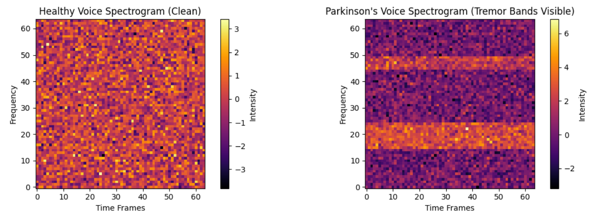
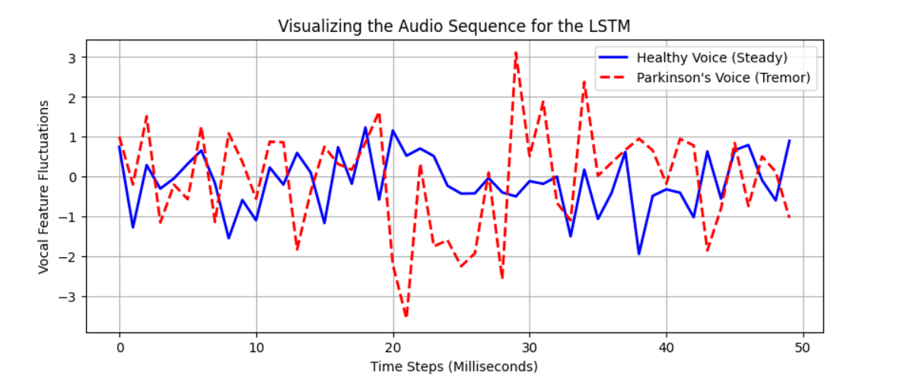
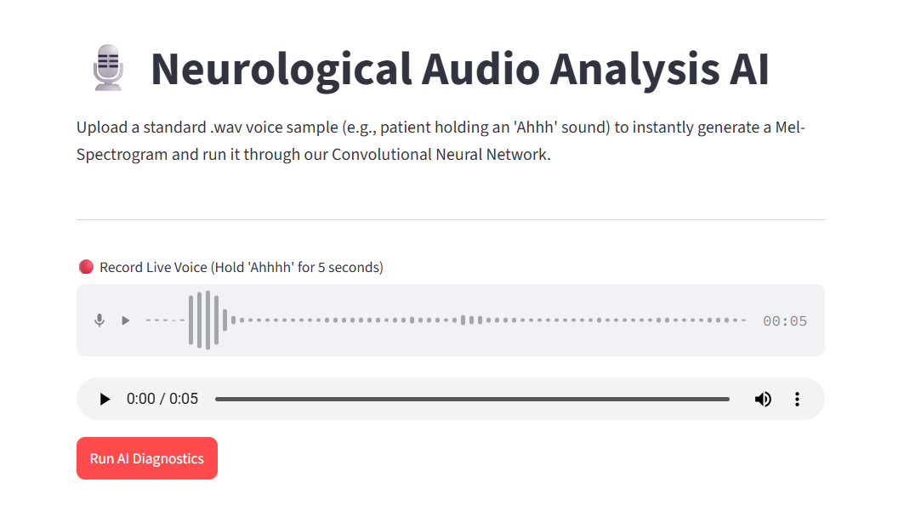
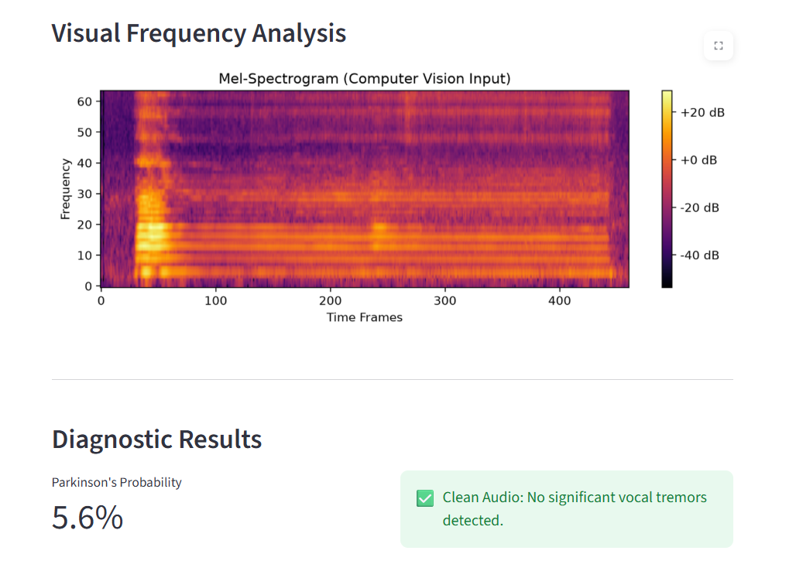

# Neurological Acoustic Diagnostic System

A non-invasive voice-screening platform for neurological conditions (Parkinson's disease). It turns voice recordings into diagnostic insights using deep learning and shows results in an interactive Streamlit app.

## Overview

Neurological conditions such as Parkinson's disease can change how a person's voice sounds, causing harmonic breakdown and frequency instability. This project analyzes voice recordings, benchmarks three deep learning architectures, and serves the trained CNN through a live dashboard.

## Features

- Converts raw audio waveforms into 2D Mel-Spectrograms using TorchAudio
- PyTorch Convolutional Neural Network (CNN) to detect harmonic breakdown and frequency instability
- Benchmarks three architectures on different data representations:
  - **ANN**: tabular voice biomarkers
  - **CNN**: spectrogram images
  - **LSTM**: temporal sequences
- Streamlit dashboard with live microphone input, real-time spectrogram visualization, and instant inference scoring

## Dataset

- **ANN (tabular biomarkers):** [UCI Parkinson's dataset](https://archive.ics.uci.edu/ml/machine-learning-databases/parkinsons/parkinsons.data) (healthy vs. Parkinson's cases).
- **CNN and LSTM:** trained on simulated spectrograms and vocal-feature sequences that mimic tremor patterns (see the training plots below), since the UCI dataset contains extracted features rather than raw audio.

## Sample Output

### Training Data (Simulated)

Healthy vs. Parkinson's spectrograms used to train the CNN. The Parkinson's sample shows tremor bands.



Audio feature sequences used to train the LSTM, comparing a steady healthy voice with a tremor pattern.



### Streamlit App

Record a live voice sample (hold "Ahhh" for 5 seconds) or upload a `.wav` file, then run the diagnostics.



The app shows the Mel-Spectrogram fed to the CNN and the predicted Parkinson's probability.



## Tech Stack

Python, PyTorch, TorchAudio, SoundFile, Praat-Parselmouth, scikit-learn, Pandas, NumPy, Matplotlib, Seaborn, Streamlit, Google Colab, VS Code

## Repository Structure

| File | Description |
|---|---|
| `Voice_Bio_Markers_for_Neurological_conditions_(DL)_.ipynb` | Colab notebook: data loading, model training and benchmarking |
| `app.py` | Streamlit dashboard |
| `parkinsons_cnn.pth` | Trained CNN model weights |
| `requirements.txt` | Python dependencies |

## Getting Started

```bash
# Clone the repository
git clone https://github.com/arjunpn03-spec/Neurological-Acoustic-Diagnostic-System.git
cd Neurological-Acoustic-Diagnostic-System

# Install dependencies
pip install -r requirements.txt

# Run the app
streamlit run app.py
```

To retrain the models, open the notebook in Google Colab and run all cells (a GPU runtime is recommended).

## Disclaimer

This is a learning and research prototype. The CNN and LSTM were trained on simulated data, so its predictions are for demonstration only. It is not a medical device and must not be used as a substitute for professional medical diagnosis.

## Author

**Arjun P Nair**
[GitHub](https://github.com/arjunpn03-spec) | [LinkedIn](https://linkedin.com/in/arjun-p-nair-770862299) | arjunpn03@gmail.com
